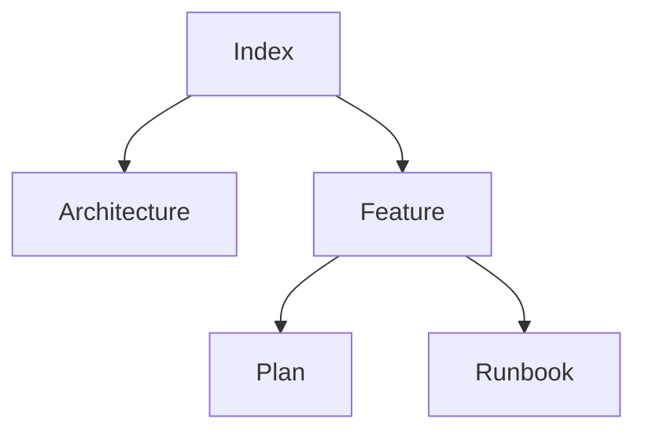

# Library

The reusable knowledge component of [Muninn](../README.md#muninn).

Human-readable onboarding and reusable repo memory, not a search log. Newcomers and read-only scouts share an entry point.

## Organize

One store holds the wiki and the code map. Do not add a second map.

Resolve `VAULT_ROOT` through [settings](../README.md#settings) and the repo. Ask if it is unset.

The index is `Projects/<repo>/Knowledge/README.md`. Link the architecture page first, then each feature page. Say that the code outline is the first section of the architecture page and of each feature page. Keep runbooks in `Projects/<repo>/Runbooks/`.

**Architecture.** Use one page for the repo, or one page for a major boundary. Say what the system is, where its edges are, and how the main parts connect. Say what it exposes, what it calls, and where the data sits. Link the run and test docs. Do not copy those commands. Read this page first for an unfamiliar repo.

**Feature.** Use one page for each feature or subsystem. Say what a person can do, the flow from entry to effect, the invariants, the boundaries, and the pitfalls. Say where a change usually lands. Organize by feature, not by directory. One feature keeps one page.

**Code outline.** Put a short outline at the top of the architecture page and of each feature page. List the entry points, the files and symbols that matter, what calls them, what they call, and a reading order. Point at the code. Do not paste code. Do not list the tree.

**Plan.** A plan is a page in that repo's library. Link it from the feature page it changes. State the goal, the decision, and the acceptance criteria. Point at the code. Do not paste code.

Use [the page template](./page-template.md). Omit a section you do not need. Link the canonical README, config, and docs. Do not duplicate commands or policy. Explain the vocabulary, flows, integrations, setup, build, test, sources, conventions, and pitfalls an incoming engineer needs. Put current guidance before history. Link decisions and ledger records. Use `tickets` to attribute a supporting page to the most specific ticket.

## Scout workflow

1. Search library terms/aliases; inspect titles and **Read when**.
2. Verify sources in code: read owning files/methods and trace affected flow.
3. On a miss, search code, then retry library with discovered symbols/subsystems. Report search scope/unresolved links.
4. Brief behavior, reuse candidates, constraints, evidence, uncertainty. Use an available read-only agent for substantial independent scouting; keep short lookups/continuous traces in-thread.
5. Patch verified discoveries, stale claims, missing explanations, or broken links only. Read-only scouts propose patches to the writer; no extra maintenance agent.

## Maintain useful knowledge

- Pages identify repo, concepts/aliases, read-when, paths/symbols, evidence, related pages, and verification: what was checked at which revision. Opening a page or changing its date proves nothing.
- Derived README table: title/link, read-when, aliases, source anchors, verification state. Rebuild after additions/renames without overwriting authored onboarding prose.
- Reuse canonical pages, including archived/superseded knowledge; preserve edits and serialize repo writes. Source changes flag affected pages for revalidation.
- Promote verified reusable discoveries, not routine searches/task state. Keep hypotheses clearly labeled in the ledger.
- No secrets/personal data in examples, commands, logs, diagrams. Never inspect `.env*`/`ssm-*.json`; use placeholders/safe references.

## Turn-end and maps

For `Stop`, follow [Ledger's checkpoint contract](../ledger/SKILL.md) and [persistence commands](../reference/persistence.md): verified patches only, stable IDs, revision checks, serialized writes and separate read-back receipts/retries. Preserve conflicts; never claim proposals applied. Prepare affected links/README tables explicitly; no automatic library indexer. Ledger, Podium, and library are separate writes, not one transaction. Slim `PreCompact` flushes already-prepared continuation/work only; no discovery or whole-library rewrites.

Add a Mermaid diagram when the relationships are the point. Do not add one that only restates a short list. Prefer a small diagram. UML/Graphify is optional for complex/unfamiliar boundaries; scope safely and verify relationships. Maps support prose, never replace it or regenerate every turn.

Acceptance: a newcomer/fresh agent finds the right subsystem, understands behavior, and locates verified build/test guidance without reading the whole repo.
