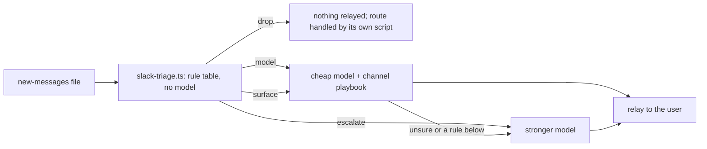

# Slack triage: prefilter, cheap-model playbooks, escalation

Who runs this: the runner that reads a slack-watch `SLACK-NEW` event (a cheap model, such as Haiku). It decides which new Slack messages the user needs to hear about, so that the expensive model reads only the hard ones.

Three layers, cheapest first:

1. **The prefilter script.** `node scripts/slack-triage.ts <new-messages file>` gives each message a verdict from the org's rule table (`slack_triage_rules`, a JSON file in the overlay). It prints one JSON line per message and no message text. Mentions, own posts, bots, bare acknowledgements, keyword rules: anything a regular expression can decide belongs in the table, not in a prompt.
2. **A playbook per channel group.** Each decision names its group's playbook (the `playbook` path). The org overlay writes them: what counts as signal and as noise in that group, the labels, and when to hand an item up.
3. **The stronger model** takes `escalate` items and whatever the cheap model hands up.

## Steps for the runner

1. Rebuild the new-messages file path as [event-types/slack-watch.md](event-types/slack-watch.md) says. Never fall back to the newest file.
2. Run `node scripts/slack-triage.ts <file>`. Exit 2 means the rules file is missing or invalid: stop and report the error line, do not triage by hand.
3. For each decision:
   - `drop`: say nothing about it. If it has a `route`, the route's own script or playbook handles it (for example a review batch that reads GitHub itself); do not relay it.
   - `surface`: it must appear in the relay. Read the line, refine the label if the playbook says to, and write one line.
   - `model`: read the line with the group's playbook and decide: relay it (with a label), or skip it as noise with a reason.
   - `escalate`: do not answer it. Hand it to the stronger model with the file path and line numbers.
4. Read only the lines the decisions point at (`file`, `line`). Read a parent post or a neighbouring line only when a reply makes no sense alone.
5. Relay in one short message: per item, who, the channel, the time in the user's zone, the label, and one line of what it is and what it needs. Lead with asks of the user.

## Labels

| Label | Means |
|---|---|
| `ask` | Someone wants something from the user: a review, an answer, a call, a decision |
| `commitment` | A date, a deadline, or a promise (by the user or someone else) that should be tracked |
| `incident` | Something is broken or down, in production or for a customer |
| `decision` | A rule, plan or direction was set that changes how work is done |
| `fyi` | Worth knowing; nothing needed |

## Hard rules

- **A mention is never dropped.** The script lifts any @-mention of the user to `surface` (label `ask` unless a rule set one), and a bare-name mention or a broadcast to at least `model`. The runner may not skip a `surface` item.
- **Unsure goes up, not out.** When the playbook does not settle a `model` item, escalate it. Never drop an item because the playbook is silent.
- **A line the script cannot parse escalates** (rule `unparsed`): a dated line in a format it does not know is never dropped. Several in a row mean the note writer changed; fix the parser.
- **No playbook, no cheap triage.** A conversation missing from the channel map escalates; add it to the map and write its playbook rather than guessing.
- **Quote nothing.** Describe each message in your own words, in as few words as the relay needs. Never copy message text into tickets, the ledger, PRs or chat, and never name patients, clients' people or anyone's personal details.
- Read-only: never write to Slack, the notes or the new-messages files.

## Changing the rules

A rule in the table has a `name`, a one-line `reason`, a `verdict`, optional `label` and `route`, and at least one condition: `channels` (tags), `authors` (display names), `match` (a regular expression over the message, with optional `flags` from `imsu`), `reply` (true for thread replies only, false for top-level posts only). `self: true` makes a rule read only the user's own posts; every other rule reads only other people's. First match wins. With no match, the user's own post is dropped and anything else goes to the model. The script refuses a table with any malformed rule and names every problem. It also refuses a pattern with a nested quantifier such as `(a+)+`, which can hang on a long message.

When the cheap model keeps making the same call on the same pattern, turn the pattern into a rule. When a rule drops something the user later asked about, fix the rule the same day.
