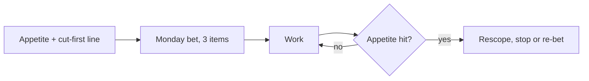

# Appetite and the circuit breaker

Read this when you start or review a long-running stream, or when you build the Monday three-item bet. Shape Up fixes the time and lets scope vary: the appetite is how much time the work is worth, not an estimate of how long it takes ([Shape Up, setting the appetite](https://basecamp.com/shapeup/1.2-chapter-03)). The circuit breaker is the rule that work is not extended by default when time runs out; it stops, and a new bet must be made on purpose ([Shape Up, the circuit breaker](https://basecamp.com/shapeup/2.2-chapter-08)). Hard external dates make this a natural fit. We apply it per stream, not in six-week cycles.

## Per stream

Write two lines in the stream's context note.

| Line | Example shape |
|---|---|
| Appetite | A number of days the stream is worth, and the date it ends |
| Cut first | The part dropped first when time is short |

## Each Monday

1. Pick at most three items as the week's bet.
2. Say aloud what is explicitly not being done.
3. For any stream past its appetite, do not let it run on: rescope it, or stop it, or re-bet it with a new appetite and a reason recorded.

A stream that quietly runs over its appetite is the failure this page exists to prevent. At least one rescope because the appetite was hit shows the breaker works.

Source: the two Shape Up chapters linked above. Cool-down time and cycles are not adopted; the weekly bet and per-stream lines are our adaptation.
