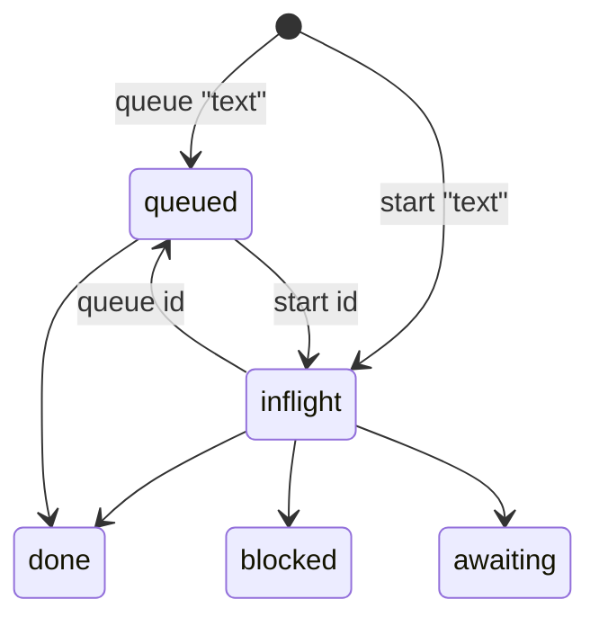

# The Ledger

Read this before running any `journal.ts` command other than plain `status` (which SKILL.md
already covers).

The user should not have to ask what happened today. The ledger is how that promise is kept.

```bash
J=<this-skill>/scripts/journal.ts
M=(--model "<your model>" --used "skill:the-maestro,tool:journal.ts")

node $J start "Port the calendar fix onto the feature branch" --repo billing-api --ticket billing-api-014 "${M[@]}"
node $J done  "Port the calendar fix" "${M[@]}"  # id or a unique substring
node $J ask   "Split the calendar change into a follow-up PR?" --blocked "the PR waits" --option "Split -- two reviews" --option "Keep -- one large diff" --recommend "Split: smaller to review" --link "https://github.com/example/repo/pull/7" --searched "reference/ledger.md, the PR diff" "${M[@]}"
node $J resolve "calendar change" --answer "Yes — no consumer yet" "${M[@]}"
node $J status                            # what is open + done today, with usage marks
node $J status --footer                   # the reply-footer Ledger lines (below)
node $J status --footer --line            # the same facts as one line; --session <id> / --stdin pick the transcript
node $J standup                           # end-of-day summary, ready to paste (no usage marks)
node $J roll                              # compress: archive the day, keep open items
node $J scratch                           # with scripts_dir set: scratch files with a promote/keep/delete-candidate proposal (roll prints it too; never moves or deletes)
node $J usage                             # counts by model and by skill/tool
```

**Usage marks.** Every `start`, `done`, `drop`, `ask`, `log`, and `resolve` passes `--model` and
`--used`; the script rejects an entry without them.

- `--model` is the model you are actually running as, stated by the harness. Do not guess.
- `--used` lists what did the work: `skill:<name>`, `tool:<name>`, `agent:<name>`.
- `--tokens` is `unmeasured` unless the harness reported a number. `--harness` is optional.
- Unknown is `unrecorded`, never a plausible name. Fix an old row with `stamp <id>`, or mark
  every unmarked row with `stamp-missing`. Both append; neither rewrites the JSONL.

Why, and the token-saving tests this feeds: `Projects/<container-name>/Research/token-usage-strategies.md` in the vault.

Storage is `$LEDGER_ROOT/Projects/{container-name}/Journal/` — a root of its own, separate from the
Obsidian vault, so the day-to-day ledger doesn't clutter vault search. `journal.ts` and
`prs-snapshot.ts` resolve the root as `--vault`, then `$LEDGER_ROOT`, then `$VAULT_ROOT` (so an
unset `LEDGER_ROOT` still works against the old single-root layout). Everything else — tickets,
`CONTEXT.md`, `DECISIONS.md`, `Plans/`, `Research/`, `Reviews/` — stays under `$VAULT_ROOT`. Pass
`--project` as the container folder's name; there is no default. `ledger.jsonl` is append-only and
is the source of truth; `CURRENT.md` and the dated archives are **generated** from it. That split
is deliberate —
The user can read and edit the markdown without any risk of breaking the log, and a compaction or a
crashed session cannot lose entries.

## What to log, and when

| Moment | Command |
|---|---|
| Starting non-trivial work, or dispatching an agent for it | `start` |
| Work you intend to do but have not started (a to-do) | `queue` (see [Queued items](#queued-items)) |
| That work lands, or the agent reports success | `done` |
| You hit something you cannot proceed past | `log --kind blocked` |
| A question only the user can answer | `ask`, with `--searched "<where I looked>"` (required, see [The ask gate](#the-ask-gate)), `--recommend` (what you would do), `--door one-way\|two-way` and, for a two-way door only, `--default` (what happens if the user stays silent; such an ask is acted on and logged, not queued: see the gate below, so leave `--default` off an ask the user must see) and `--decide-by` (`2d`, `2026-10-09`). No door means one-way, and a one-way ask is refused a default. `--class expedite\|fixed-date\|standard\|intangible` (default standard) |
| A decision that is genuinely still pending | `ask --kind decision` (stays on the board until `resolve`d) |
| A rule or decision the user already made, once it is saved in a memory file or DECISIONS.md | `rule "<text>" --ref <file>` (see [Rules](#rules-are-records-not-asks)) |
| They answer it | `resolve --answer "..."` |
| A finding worth remembering that isn't a ticket | `log` |
| The user grants permission, standing or one-off | `log --kind decision --approval standing\|one-off` (see [Approvals](#approvals)) |

Log at the **same moment** you'd tell the user about it. If you're about to write "I've finished X" in a
reply, `done` it first. The ledger is not a second job — it is the same sentence, written once
somewhere durable.

**Do not log:** lookups, status checks, anything a ticket already owns in full. A ledger entry is a
pointer to work; the ticket holds the detail. When both exist, pass `--ticket <id>` and let the link
carry the weight.

## Queued items

An open item is **in flight** (someone is working on it now) or **queued** (a to-do that has not started). Without the second state every to-do reads as running work and the in-flight count means nothing.



| Command | Effect |
|---|---|
| `queue "<text>" --stream S --model m --used n` | Open an item already queued (`--repo`, `--ticket`, `--stream` as for `start`) |
| `queue <id>` | Move an open in-flight item to queued. Appends a `queue` row; the item's own row and history are untouched |
| `start <id>` | Promote a queued item to in flight. Appends a `promote` row. `start "<text>"` still opens a new item |

Both id forms are idempotent (an item already in the target state is reported and nothing is written) and refuse a closed item or one that is not an in-flight `wip` item. A single 4-character token that has a digit and matches no item is rejected as a probable mistyped id; pass `--text "<word>"` to queue it as text. `queue` and `promote` are event rows, not items; the latest one for an item wins, and `verify` checks that each points at an existing id.

Queued items stay **open**: `done`, `drop`, `defer`, `tag`, `carry` and `archive`'s blocker check treat them like any open item, and `roll` leaves them on the board (its summary names the count). `status`, `CURRENT.md`, `standup` and `prime` list them under **Queued**, after In flight, and the handoff tags them `queued`. The triage box is still 7 (In flight), but a queued item is never stale, since it has not started. The `to run` count (paste blocks) is unrelated and unchanged.

## The ask template

Every ask that reaches the user fills a template, like the fields of a ticket. `ask` checks it when the row is written and refuses with every missing field named, writing nothing.

| Field | Flag | Rule |
|---|---|---|
| Question | the text after `ask` | one line |
| What is blocked | `--blocked "<what waits>"` | required |
| Context | `--context "<bullet>"`, repeatable | optional |
| Options | `--option "<option> -- <its cost>"`, repeatable | at least 2, each with a cost after ` -- ` |
| Recommendation | `--recommend "<what and why>"` | required |
| Links | `--link <url>`, repeatable | at least 1 that opens: `https://` or `obsidian://` |
| What I checked | `--searched` | required (the ask gate below) |

The same fields can come from `--body-file <file.md>` with the headings `## Question`, `## What is blocked`, `## Context`, `## Options`, `## Recommendation`, `## Links`, `## What I checked` and `## Door` (bullets under the list sections). A flag wins over the file, field by field; an unknown heading is refused.

```bash
node $J ask "Ship the calendar change Friday or Monday?" --blocked "the release waits on the date" --context "CI is green" --context "two reviewers are out Friday" --option "Friday -- a weekend fix if it breaks" --option "Monday -- one more day on the old behaviour" --recommend "Monday: nothing is lost and a reviewer is back" --link "https://github.com/example/repo/pull/7" --searched "the PR checks, the release notes" "${M[@]}"
```

Exempt by design: `--paste` asks (the block file is the content) and a two-way ask with a `--default` (acted on as a note, never queued). Asks the tooling raises itself (the roll's env-store ask, the continuity decision scan) carry a fixed template that points at the README, through the same validator. Older asks keep the free-text layout on the Podium.

## The ask gate

`ask` is a gate, not a note. Everything below is checked by `journal.ts` when the row is written, and a refusal exits 1 with nothing written.

- **Searched first.** `--searched "<where I looked>"` is required on every `ask` (a paste ask too): the docs, code, library page or ledger rows checked before the question was put to the user. It is stored on the row as `searched`, one line of at most 300 characters. Without it `ask` exits non-zero and says why. `--searched` is refused on any other command.
- **The door routes.** A two-way ask with a `--default` is acted on and logged, not queued: the row is a `note` reading `acted on default: <default> (asked: <question>)`, it carries `actedOn` and `searched`, and the command prints `acted <id>`. It never reaches the board. A one-way ask, a two-way ask with no default, and any ask flagged `--outward` are queued for the user.
- **`--outward`** marks anything another person sees (Slack, Jira, email). It always asks and is never acted on. An `--outward` ask with a `--default` is refused (the default could never fire). `autoDefault` (the one reader every consumer uses) returns null for an outward row, so a hand-edited row cannot act either, and `verify` flags such a row. A `question` row is written only by `ask`: `log`/`note --kind question` is refused so the gate cannot be walked around. `--outward` is refused on any other command.

Not built yet (the-maestro-243 follow-ups): a daily ask budget with draft overflow, and answers that write a topic-scoped rule.

## Rules are records, not asks

A `decision` row is a record of something already decided, so it is **not open**: it never shows as "awaiting you". Only `ask --kind decision` writes a decision that is still pending (`pending: true`); it stays on the board until `resolve`d.

Record a rule or approval the user has already stated with `rule`, after saving it somewhere durable:

```bash
node $J rule "branch from staging, except example-scraper" --ref ~/path/to/memory-file.md --model ... --used ...
```

`rule` refuses (exit 1, nothing written) unless every `--ref` is an existing file (`~/` and relative paths allowed; the row stores the absolute path), so "promoted" is checked when the row is written, not just described. Any file counts, including an empty one, and a path containing a comma cannot be a ref (refs are comma-separated). It takes `--approval`, `--scope`, `--stream` and the usual flags. Plain `log --kind decision` still works for a decision with no file behind it; it is just never open. Rows written as open decisions before this change read as closed records now.

## Learned facts

`learned` records one fact the moment someone establishes it, so a later session does not re-derive it. It is the one write path for `kind: learned`; `log --kind learned` is refused.

```bash
node $J learned "The example page count is the page length, not the total." --kind how-it-works --applies-to example-repo:example-api:staging --evidence "docs/spec.md:120" --verified-at "2026-10-08 read the spec" --confidence observed --model ... --used ...
```

Required: the claim (one line, present tense, at most 400 characters), `--kind` (`how-to`, `how-it-works`, `gotcha`, `decision`, `tool`), `--applies-to repo:component[:env]` (env is `local`, `dev`, `stg02`, `staging` or `prod`; when a container root is set the repo must be a directory in it), `--evidence` (a file:line, PR, note path, or a command and the count it printed), `--verified-at` (a 7 to 40 character sha, or `YYYY-MM-DD` followed by how it was checked) and `--confidence` (`observed`, `told-by-jack`, `inferred`). Optional: `--supersedes <earlier learned id | page path>`, which must name a learned row that exists when it is an id.

Every refusal exits 1 and writes nothing, and a refusal never prints the value that failed. The claim, evidence, location, verified-at and supersedes pass the shared scanner (`scripts/lib/secret-scan.ts`): credential shapes (private key blocks, cloud and token prefixes, JWTs, URL credentials, secret-word assignments, long mixed-case blobs) and fixed-shape PHI (SSNs, phone numbers, emails, dates of birth, MRNs). A clean scan means no known shape, not that the text is safe: write claims about systems, ids and counts only. `verify` runs the same rules over stored learned rows, so a hand edit cannot carry what the write refused. Writing the same claim, location and evidence again reports the existing row.

## Shared documents

When the user hands you a document (a spec, a checklist, a design link, a note) record it on the same turn with `shared <path-or-url> --project <p> --title "<what it is>" [--why "<one line>"] --model ... --used ...`, so the project's tab lists it for whoever picks the project up next. Only a pointer is stored. A path must be an existing file under the notes vault or the container root; a link must be `http(s)` or `obsidian://open`. File names that can hold secrets and any title, reason or link that looks like a secret or PHI are refused, and a refusal never prints the value. An exact repeat is reported, not written twice. `log --kind shared` is refused.

## Approvals

Any time the user grants permission, log it with `--approval`, so it can be reviewed later instead of staying buried among other decisions:

```bash
node $J log "may resolve declined bot threads" --kind decision --approval standing --scope "bot threads only" --ref <memory-file-or-url> --model ... --used ...
node $J log "yes, retarget #3934" --kind decision --approval one-off --model ... --used ...
```

- **`standing`** is a permission that keeps applying ("you may resolve declined bot threads", "merge the base into my branches"). Give it a `--scope` saying what it covers, and a `--ref` to wherever it is also recorded. If the install keeps memory files, save a standing approval there too and pass that file as `--ref`.
- **`one-off`** covers a single action ("yes, retarget #3934"). It is logged for awareness and needs no follow-up.
- `approval` is its own field, not a stream: streams are workstreams. Any other value is rejected.
- When the user answers an `ask` with an approval, put the flag on the answer: `resolve <id> --answer "..." --approval one-off`.
- To mark a decision that was already logged, use `approve-tag <id> --approval standing|one-off [--scope ..] [--ref ..]`. It appends an `approval-tag` row; nothing is rewritten, and the latest tag wins. `verify` checks the values and that every `approves` reference exists.

### Weekly approvals review

`journal.ts approvals [--since YYYY-MM-DD | --days 7] [--until YYYY-MM-DD] [--out <path>] [--force] [--json]` collects approval rows and their tags and writes a review doc, by default `$VAULT_ROOT/Projects/<container-project>/Reviews/approvals-<ISO-week>.md` (`--tickets-vault` overrides the vault), with `type: review`, `status: draft` and `week: YYYY-Www`. It never overwrites without `--force`, and it appends nothing to the ledger. `--days N` covers exactly N calendar days ending on `--until` (default today, inclusive), so `--days 7` run weekly never overlaps; the default is 7 and N must be at least 1. `--since` sets the first day instead, and `--until` the last. The file is named after the ISO week of the window's end date. `--json` prints the groups and writes no file.

- **Standing approvals**: date, text, scope, ref and source row id, each with the line `- [ ] keep  - [ ] narrow  - [ ] revoke`.
- **One-off approvals**: date, text and ref, for awareness only.
- **Untagged decisions**: `decision` rows in the window with no approval. Classify any that were permissions with `approve-tag`.

Once a week, on the first session of `approvals_review_day` (local config, default Friday), the morning greeting runs `journal.ts approvals --days 7`, links the doc, and asks the user to tick keep, narrow or revoke for each standing approval. Then update every place a narrowed or revoked approval is recorded (memory files, config, instructions), and log the outcome.

## Workstreams (tags)

To pull a slice of work out into its own section, e.g. "Launch" on a go-live day or "Today" for today's priority, pass `--stream <name>` to `start`/`ask`/`log`/`fact`, or file an existing item with `journal.ts tag <id> --stream <name>`. `status`, `standup` and CURRENT.md show each stream first, under its own heading, then everything else. Clear it with `--stream none` once the push is over. `none` is reserved: on `start`, `ask` and `log` it records no stream, on `tag` it clears the stream, and `streams add none` is refused. Older rows that stored a stream literally named `none` read as unstreamed; the ledger is never rewritten. Use a stream only when the user asks to track something separately; the default is no stream.

**An epic is a stream.** An epic is a ledger stream, e.g. `Launch`; retro and archive key on the stream.

### The stream registry

`$LEDGER_ROOT/Projects/<container-name>/streams.json` is the registry: `{ "streams": { "Launch": { "aliases": ["launch", "launch-v2"], "status": "active" } } }`. Without the file nothing is enforced and streams are free text, as before.

On write (`start`, `log`, `ask`, `tag`, `fact`, `carry --to`) the name is folded to the canonical one, so `launch`, `LAUNCH` and `launch-v2` all record `Launch` (a `normalised launch -> Launch` note goes to stderr). An unknown name is rejected with a did-you-mean suggestion and nothing is written, unless you pass `--new-stream`, which adds it to the registry. A stream marked `archived` rejects writes until `unarchive`.

On read, `fold` maps every row's stream through the registry, so old `launch` rows show under `Launch` with no backfill. The ledger is never rewritten, and deleting `streams.json` restores the raw spellings.

```bash
node $J streams                                   # list: status, aliases, open/done/dropped/total per stream
node $J streams add Security --alias sec          # idempotent; refuses an alias that belongs to another stream
node $J streams check                             # dry run: how many items would change display stream; appends nothing
```

### Model names

Model and tool tags are normalised so usage can be metered. `scripts/lib/ledger-tags.ts` holds the canonical model ids with their aliases, the tool alias table and the script extensions to strip, as data. On write (`--model` on any command, `--used`, `stamp-missing`, and every append through the store) a model alias or case variant is recorded as the canonical id, and `tool:` marks lose `.mjs`/`.ts`/`.js`/`.sh`/`.py`, are lowercased and aliased, so `tool:journal.mjs` and `tool:journal.ts` are both `tool:journal`. On read `fold` applies the same maps to every item's and closing row's `model` and `used`, so `usage`, `status` and the web views show one name for old rows too; the ledger is never rewritten. An unknown model warns on stderr and is written as it came: the ledger has odd historic values, and a wrong-but-recorded model beats a rejected entry. The sentinels `unrecorded`, `n/a` and `unmeasured` pass through silently. Scripts and hooks that write rows without an LLM involved (loop, sweep, hook writers) record `--model n/a`; `unrecorded` is for a person or agent who really does not know. `usage` prints the unrecorded share of each tag. The same `streams.json` may carry a `models` section: `{ "models": { "claude-opus-5-5": { "aliases": ["Claude Opus 5.5", "opus"] } } }`, which extends and overrides the built-in table. A file with `models` but no `streams` does not enforce stream names.

```bash
node $J models add claude-opus-5-5 --alias "Claude Opus 5.5,opus"   # idempotent; refuses an alias owned by another id
node $J models list                                                 # ids, aliases, rows per id
node $J models check                                                # dry run: each spelling in the ledger, its status (canonical, alias, unknown) and target
```

## Epics: facts, retro, carry, archive

A finished epic gets a retro doc in the vault and then leaves the default views. Nothing is deleted at any point; every step is an appended row.

```bash
node $J fact v1_visits_full_min=79 --stream Launch "${M[@]}"   # a structured metric; not an item, never open
node $J retro Launch [--out <path>] [--force] --tickets-vault "$VAULT_ROOT"
node $J carry <id> --to Maestro "${M[@]}"                        # re-home an open follow-up
node $J archive Launch "${M[@]}"
node $J unarchive Launch "${M[@]}"
```

`fact <key>=<value>` appends a `fact` row for a stream. Facts feed the retro's facts table and are ignored by `status` and the open counts.

`retro <stream>` drafts `Projects/<repo-or-dev-env>/Archive/<stream>-retro-<date>.md` under the vault (`--tickets-vault`, else `$VAULT_ROOT`; `--repo` picks the folder, default `dev-env`; `--out` overrides the whole path). It has front-matter `status: draft` and these sections: Summary (done, dropped and open counts, date span), Timeline (first and last row, rows per day), Facts, Shipped (done items that mention a PR or release, with their `#NNNN` refs), Tickets referenced (with current status from the ledger index), Learnings (notes matching learned, lesson, ruled out or cause), Open follow-ups (including items carried elsewhere) and a "Promoted to" checklist with one line per learning and a blank target. It never overwrites an existing file without `--force`, and it appends nothing to the ledger. Opus polishes the draft and the user reviews it, then `status:` is changed from `draft`.

`carry <id> --to <stream>` appends a `carry` row that re-homes the item and remembers where it came from.

`archive <stream>` refuses, and lists every blocker, unless all of these hold: the stream has no open items (finish each one, or `carry` it); a retro doc for it exists with `status:` not `draft`; every "Promoted to" line has a target or `one-off`. Then it appends one `archive` row with the stream, the item ids and the retro path, and marks the stream `archived` in the registry. `--retro <path>` names the doc explicitly; otherwise the newest `<stream>-retro-*.md` in the Archive folder is used.

`status`, `standup`, the `render` that writes CURRENT.md, and the `ledger-index` search and queries hide the archived items by default. Pass `--include-archived` to show them. `unarchive <stream>` appends the reverse row and marks the stream active, and the folded items, stats and search counts come back exactly as they were.

## The footer lines

`status --footer` prints the Ledger lines and the Session line of the reply footer, so those two are never typed from memory:

```
**Ledger (Launch):** 1 done today · 1 in flight · 0 awaiting you
**Ledger (Maestro):** 0 done today · 0 in flight · 1 awaiting you · 1 blocked
**Ledger (other):** 0 done today · 1 in flight · 0 awaiting you
**Session:** 86 turns · ctx 142k of ~200k (71%) · 129k read/turn · roll soon
```

One line per active stream (a stream with an open or done-today item), named as the registry spells it, then `Ledger (other)` for items with no stream. `· 12 in flight (7 stale, 3d+ with no lease)` marks in-flight rows at least three days old that hold no live lease: the count is rows, and these are the ones nothing is known to be working on, so confirm each alive or `drop` it. `· N blocked` appears only when something is blocked, and `· N queued` (straight after in flight, e.g. `1 in flight · 3 queued · 0 awaiting you`) only when something is queued. With no streams at all it is the single `**Ledger:**` line. After them, when a PR snapshot exists, comes `**Review queue:** N of 4` (open non-draft PRs against `review_queue_cap`; `(full)` at the cap, and a note when the snapshot is over ten minutes old; a snapshot over 30 minutes old is not shown: the footer reads GitHub live instead, and prints `unknown (snapshot 11h old; live refresh failed)` when that read fails; a count above the cap says by how much), then the Session line. After a compaction the Session line reads `N turns since compact (M before)`: N, the context and read/turn count from the last compact, M is the turns before it, and the roll percent uses the context, not a turn count. Archived streams are left out; `--include-archived` and `--date` work as they do for `status`.

`status --footer --line` prints the same facts on one line, summed across streams (the review queue, loop and session follow when they apply):

```
Ledger: 0 done · 2 in flight · 0 awaiting | Loop: ok <1 min | Session: 103 turns (57%) · 159k/turn
```

The multi-line form is the script's default and is what a session-opening greeting, a status, board or PR-board request, or an explicit ask for the footer gets. An ordinary reply pastes the `--line` form. Both print the same figures and the same `roll soon` / `roll now` ending.

`status --json` carries the same figures as data under `footer` (`ledger`: one `{ name, done, inflight, queued, awaiting, paste, blocked }` per line; `session`: the turns, percent, read per turn and advice), and the Podium's **Status** section is formatted from it, so the page and the footer never disagree.

The Session line comes from `token-metrics.ts`: the most recently modified transcript in `projects_dir`, its turn count, its last turn's context against the autocompact trigger (the live `CLAUDE_AUTOCOMPACT_PCT_OVERRIDE`, else the native ~967k) and its mean cache-read per turn, e.g. `**Session:** 86 turns · ctx 142k of ~200k (71%) · 129k read/turn · roll soon`. The shown percent is of the trigger. When the context reaches `roll_warn_pct` (default 60) of it the line ends `· roll soon`; at `roll_at_pct` (default 90) it ends `· roll now` instead. `roll_turns` and `roll_read_per_turn` are retired and ignored. What the orchestrator does at each level is in [cost/budget.md#session-hygiene](../cost/budget.md#session-hygiene). With no transcript in that directory it prints `**Session:** unavailable (...)` and does not vanish. An unset `projects_dir` follows `container_root` when that is set, else the transcript directory of the working directory the script runs from, which is usually not the orchestrator's; `token-metrics.ts` warns on stderr when the directory it resolved has no sessions.

## Per-stream views

`render` writes `Journal/Streams/<Stream>.md` for each active stream, beside the combined `CURRENT.md`. A page has four sections, In flight, Blocked, Awaiting you and Done today, drawn from the same fold as the board, so the counts agree with `status --footer`. Streams the registry lists as active but that have nothing open get a page of `_none_` rather than a stale one. An archived stream's page carries a link to its retro instead of a board. `CURRENT.md` links every stream page from the stream's heading, and lists archived streams. All of it is generated; edit nothing there.

**Why the ledger is not split per stream.** The streams live in the one `ledger.jsonl`, and the views above are generated from it. Splitting the JSONL would buy nothing a view does not already give, and would cost the properties that make it trustworthy: one file means one total order of rows, ids that are unique by a single check (and `verify` can check them), and `carry` as one appended row instead of a write to two files that could disagree after a crash. A single append-only file is also safe with one writer at a time, and concurrent appenders are covered by the single-`write()` append tested under [Claims](#claims). If the file ever gets slow, compact archived streams (see the archive section) rather than partitioning live ones.

## Integrity and backup

`verify` checks the raw file: every line parses, ids are unique, and every `closes`, `carries`, `tags`, `annotates`, `approves` and archive `ids` reference exists, and every `approval` value is `standing` or `one-off`. It exits 1 with the offending lines, so run it after any hand edit of `ledger.jsonl`.

With `ledger_git_autocommit` on (config file or `MAESTRO_LEDGER_GIT_AUTOCOMMIT`) and `$LEDGER_ROOT` a git repository, `roll` runs `verify` and then commits what changed under the root as `chore(ledger): roll <date>`. Paths are listed from `git status` (ignored files never appear) and staged one by one with `git add -- <path>`; the commit is limited to those paths. A failing `verify` blocks the commit and `roll` exits 1. The repo is local: nothing here pushes, and no remote is needed. A suitable `.gitignore`: `**/Index/*.sqlite` (the derived index) and temp files.

## Claims

Across sessions, one-writer-per-worktree needs a shared fact. `claim <repo> --desk <stream> [--worktree w | --branch b]` takes `Claims/<repo>.lock`, or `Claims/<repo>@<scope>.lock` when a worktree or branch is named (the scope is the name with anything outside letters, digits, `.`, `_`, `-` turned into `-`). Claims on different scopes of one repo coexist; a claim with no scope (what every claim was before this, so an old `<repo>.lock` still stands) conflicts with all the others, and so does a second claim on the same scope. `release` takes `<repo>@<scope>` or `--worktree`/`--branch`; with neither it releases the desk's only scoped claim on the repo if it has exactly one. `brief` takes `--worktree`/`--branch` the same way. The lock is taken under the ledger root with an exclusive create (`O_CREAT|O_EXCL`), which is the runtime guarantee: two processes racing, exactly one wins. The `claim` ledger row is only the record; `release` deletes the lock and appends `released`. `claims` lists them with a stale check (pid not running on this host, or older than `--stale-hours`, default 12). A claim recorded without `--pid` is judged on age alone. Stale claims are never removed automatically.

```bash
node $J claim billing-api --desk Launch --branch feat/x "${M[@]}"   # exit 1 and the holder's name if taken
node $J release billing-api --desk Launch "${M[@]}"                 # holder only; --force overrides and says so in the row
node $J claims --json
```

**Concurrent appends.** The ledger takes no lock, and needs none: `appendFileSync` issues one `write()` on an `O_APPEND` descriptor, so concurrent rows land whole and in some order. `journal.cases.ts` has a test that runs several processes appending at once and asserts every line parses, ids are unique and the count is exact, and it passed without adding a lock (also stress-checked once at 8 processes x 40 rows). The one residual risk is `newId` picking the same four characters in two processes inside the same instant; `verify` reports duplicates. `append` and the backfill batch (`appendMany`) each use a single write.

Desks and the hub/desk split that uses claims: [desks.md](desks.md) (draft).

## Backfill

`backfill` (default `--dry-run`) infers a stream for items that have none, from four signals: a shared ticket id, a registry name or alias in the text, the repo, and neighbouring tagged rows in the same session (a session is a run of rows with no gap over 30 minutes; the ledger has no session field). Each signal votes with points (ticket 4 or 1, keyword 2, repo 2 or 1, session 1), votes for the same stream add up, and the total maps to `high` (4+), `medium` (2-3) or `low` (1). Disagreement caps a proposal at `low`; a tie proposes nothing. Items with no signal stay unstreamed, which is legitimate.

```bash
node $J backfill --samples 3 --out backfill-report.md             # counts per proposed stream and confidence, samples, a review table
node $J backfill --apply --min-confidence high "${M[@]}"          # append tag rows for high proposals only
```

`--apply` appends `tag` rows (`backfill: <run-id>`, `rule`, `confidence`, `prev`) in one write and renders once. It is idempotent, and it is a review step: read the dry run and a sample of the medium proposals before applying anything below `high`.

## Handoff and resume

At the end of a piece of work, before `roll`, scaffold the handoff for the stream; at the start of a fresh session, run `resume`.

```bash
node $J handoff --stream Launch [--out <path>] [--since YYYY-MM-DD] [--delta] [--force]
node $J resume
```

Run the [branch sweep](#branch-sweep) first and put its table to the user, so the handoff leaves no
merged branches behind unreviewed. `handoff` itself fills **Cleanup candidates** with the worktrees the
[roll cleanup](#roll-removes-stale-worktrees) would keep, each with its reason (read-only; `--container <dir>`
picks the directory, default the current one; `--no-worktree-sweep` skips it).

`handoff` writes `Journal/HANDOFF-<date>-<stream>.md` with `status: draft` and appends nothing. It never overwrites without `--force`. Its five headings: **1. Tasks with status** (the stream's open in-flight and blocked items, a blocked one with its gate, then items done since `--since`, default yesterday); **2. Learnings, including what was ruled out** (items matching learned, lesson, ruled out or cause; when nothing matches it prompts the author, because the ledger cannot derive it); **3. Artifacts** (PR numbers, refs, tickets and file paths mentioned by those items, listed once); **4. Decisions awaiting** (generated from boxes 4 and 5: **Needs Jack**, every open question and pending decision except paste asks, then **Paste blocks for Jack** with each block file; stale ones are marked); **5. Next concrete action** (blank, for the author), then an unnumbered **Standing pickups** block (every row, copied unedited), a required unnumbered **Commitments and conditions** section (every standing pickup that is not built in, and every open `decision` ask, each as id, status, due time and kind only, never typed text; `_none_` when there are neither; `prime` prints the same pickups first, overdue ones first, at most six lines), and an unnumbered **Cleanup candidates** placeholder (the `--delta` handoff repeats the Commitments section whole, because it is current state, not a change) that points at `branch-sweep.ts`. Edit it, then set `status:` past `draft`.

**Repeat rolls: `--delta`.** Every handoff carries a `generated_at` marker. `handoff --delta` (stream or `--all`) looks for today's newest `HANDOFF-<date>[b..z]-<stream>.md`: with none it writes the full handoff; with one it writes the next suffix (`HANDOFF-<date>b-<stream>.md`) with only what the ledger gained after that marker (new items, completed items, new asks, PRs mentioned), skips the worktree sweep, and names its predecessor in `delta_of`. It refuses a previous handoff with no marker (use a full one with `--force`) and stops after `z`. `roll` is unchanged and idempotent: it regenerates the day's archive whole.

For an end-of-session handoff run it once over everything: `handoff --all --learn "<what was ruled out>" --next "<the first step>" --update-context`. `--all` covers every stream and tags each item with its stream; `--learn` and `--next` fill sections 2 and 5 (one line each); a **Session metrics** section carries the newest session's turns and read per turn from `token-metrics.ts` (or says why none was found); with `--all` the dry-run sweep is summarised as counts by reason (`--verbose` lists each worktree); `--update-context` points the project `CONTEXT.md` (`--context-file <path>` to name another) at the new note with one `Latest handoff: [[note]] (date)` line, replacing the previous one. It is still a draft: read it before you set `status:`.

`resume` runs the scriptable half of the verify-on-resume list: ledger `status`; `gh pr list --author @me --state open --json number,title,url` if `gh` is installed and `resume_gh` is not off (otherwise a `gh: unavailable` or `skipped` line, exit 0); the [gate check](#prime-gates-and-defer); `pgrep -f` for each `loop_patterns` entry (`ok` or `MISSING`). It then prints that **`ListAgents` must be called by the session itself**, since it is a harness tool. All settings come from local config ([local-config.md](local-config.md)), never from the script.

## Ledger or ticket?

They are different tools and both are cheap:

- A **ticket** is a problem that needs fixing, with evidence. It outlives the week.
- A **ledger entry** is a record of activity. It outlives the session.

Filing a ticket is itself worth a ledger line (`--ticket <id>`); the reverse is not true.

## Boxes and triage

Everything open falls into one of eleven boxes. `triage` sorts them and says what to do about each; the first matching rule wins.

| # | Box | Rule | Action |
|---|---|---|---|
| 1 | Decisions / rules | a `decision` (not pending) | promote to a memory file, then `rule --ref`; closed once a ref file exists |
| 2 | Standing approvals | effective approval `standing` (the row, its closing row, or an `approval-tag`) | same as 1 |
| 3 | One-off approvals | approval `one-off` | close once a ref file exists |
| 4 | Needs Jack | a question (or `ask --kind decision`) that asks the user to choose or know something | carry; stale after 2 days |
| 5 | Paste blocks | `ask --paste <file>`, or a question with run/paste/yourself/block wording and no `?` | carry in its own list with the file; stale after 2 days |
| 6 | Blocked / gated | `blocked` | carry with the gate written out |
| 7 | In flight | `wip` (queued ones too, never stale) | carry; stale after 1 day: confirm alive (`ListAgents`, branch sweep) or drop |
| 8 | Incidental findings | a note saying "could not be filed", "follow-up", "next session" or "TODO" with no ticket | file a ticket, then log a pointer |
| 9 | Learnings | a `learned` row, or a note with learned, lesson, ruled out or cause | copy into the handoff and the repo's CONTEXT.md |
| 10 | Done | `done`, `dropped` | `roll` archives |
| 11 | Noise | any other note | archive silently |

Classification is by kind plus regex, so it is a proposal you can read, not a verdict. Wording alone never makes a question a record (boxes 1 to 3 need a decision row or an explicit approval), because `--apply` closes records. An approval is tested before the generic "recorded rule" text rule so that boxes 2 and 3 can be reached.

```bash
node $J triage [--date D] [--since D] [--json]   # read-only
node $J triage --apply [--dry-run]               # append resolved rows for boxes 1-3 whose ref is an existing file
```

`triage` looks at every open item (any age) plus decisions and notes dated `--since` (default `--date`, default today) that nothing has closed. It prints each box with its items, then **Blockers**, **Stale**, and the **don't-miss checklist**. The checklist marks `[x]`/`[ ]` where the ledger can tell (rules promoted, findings ticketed, Needs-Jack items long enough to stand alone, paste asks with a file) and says "(by hand)" for the rest (a HOW-WE-WORK line, the handoff draft, gates, running agents, session metrics): those need the session.

Blockers are what `roll --strict` refuses on: a box 1-3 item with no `--ref` that is an existing file (not promoted yet), and a box 8 finding with no ticket.

`--apply` is append-only and runtime-checked: it appends `resolved` rows reading "recorded → <ref>" for box 1-3 items whose ref resolves **at that moment** to an existing file. An item with no resolvable ref is left open and counted. `--apply` only looks at records dated `--date` (it ignores `--since`), and dates its rows with `--date`. Closed items leave the scope, so a second run appends nothing. It writes nothing outside the ledger.

### Paste blocks

`ask "<what to run>" --paste <block-file>` records a run-this ask. The file must exist (checked before the write); the row carries `box: paste` and the absolute path. `status`, `CURRENT.md`, the footer ("N to run") and the handoff show these apart from the questions, so "awaiting you" means decisions only.

A command only the user can run (a denied tool call, an allow rule, a ticket close) is registered rather than pasted: `script add --kind one-time|reusable --title ... --what ... --why ... --after ... --blocks <id> -- <command>` writes an entry to `Journal/scripts.jsonl`, the command to `Journal/script-blocks/<id>.sh`, and raises a paste ask whose row carries `script: <id>` so the Needs-you card links to the Scripts tab. The state is folded, not stored: the script is *blocked* while that ask is open, then a one-time script is History and a reusable one stays listed. `script list` and `script ran <id>` read and record. See the README's "Scripts you are blocked on".

The block is linted first: `ask --paste` runs `scripts/paste-lint.ts` over the file and, on any finding, exits 1 naming the rule and the fix and writes nothing. Run `node scripts/paste-lint.ts <file>` (or pipe a block to it) on any command block before it goes to the user, in a reply as well as in an ask. The rules are the user's zsh habits: no inline `#` comments, command variables as functions, `${X:r}` not `$X:r`, an absolute `node` for `.ts`, no `gh pr merge` or approve, and psql never takes a URI together with `-d` (psql ignores `-d` then and hits the URI's database). The right form puts the database in the URI path: `psql "postgres://user@host:5432/<db>" -c "select 1"`.

## Prime, gates and defer

```bash
node $J prime                                  # the box view for session start and after a compaction
node $J log "<what is blocked>" --kind blocked --gate gh:pr:<repo>#N|date:YYYY-MM-DD|ticket:<id> --model ... --used ...
node $J defer <id> --until YYYY-MM-DD --model ... --used ...
```

**`prime`** prints at most 40 lines, however much is open: the day's streams, then **Needs Jack**, **Paste blocks for Jack**, **Blocked / gated**, **In flight** and **Queued**. When they do not fit, the boxes share the lines evenly and each says how many it hid (`… +N more`). It reads only the ledger (no `gh`, no `--model`) and appends nothing, so it is safe in a SessionStart hook. The one network step is the update check: a `git fetch` of the skill's own repo (15 second cap), reported as a single line above the board when the checkout is behind, ahead, diverged or dirty and omitted when it is current; `--no-update-check` or `update_check: off` skips it, and `auto_pull: on` fast-forwards a clean, purely-behind checkout (`git merge --ff-only` only). While `auto_pull` is neither on nor off, a second line (`auto_pull is not set ...`) follows the update line each session; `journal.ts autopull on|off` answers it. The cap holds whatever the content: text is clipped to one line, and a final guard trims to 40. (Like `status`, it regenerates the derived `CURRENT.md` and stream pages once on the first read of a new day, but only when a `defer` row exists, so an expired deferral reappears there.) Run it at the start of a session and again right after a context compaction.

**Gates.** A blocked item can name what it waits for: `gh:pr:<repo>#N` (merged), `date:YYYY-MM-DD` (that day has arrived), or `ticket:<id>` (closed in the tickets vault). `--gate` is only valid on `--kind blocked`, and a malformed one exits 1 before anything is written. `resume` checks each gate in a **Gates** section and reports `waiting`, `CLEARED` or `UNKNOWN`. It is report-only: a cleared gate prints the `resolve` command to run, and nothing is closed or promoted for you. `UNKNOWN` means the lookup could not say (`gh` missing or failing, `resume_gh` off, a PR closed without merging, no tickets vault, ticket not in the index). A ticket gate reads the derived ticket index, which `ledger-index` rebuilds when stale: that is a derived file, never a ledger row. `gh` is called as `gh pr view <N> --repo <repo> --json state,mergedAt`.

**`defer`** hides an open item from `status`, the footer, `CURRENT.md`, stream pages and `prime` until the given date. It appends a `defer` row (the item is untouched); the date must be in the future, the item must be open, and the latest `defer` wins, so deferring again moves the date. `triage` still lists a deferred item, marked, and never calls it stale. The handoff file and `archive`'s blocker check deliberately still list it: a handoff should be complete, and an epic is not finished while an item is merely parked. There is no un-defer: defer to tomorrow, or close the item.

## Compression

`roll` is the compressor. (It also removes stale worktrees, see [Roll removes stale worktrees](#roll-removes-stale-worktrees).) It writes the day's finished work to `Journal/YYYY-MM-DD.md`, leaves a
`[[link]]` in `CURRENT.md`, and **keeps open items on the board** — in flight, queued, blocked, and awaiting
the user all survive the roll, because they are still true tomorrow.

`roll` first runs `triage`. Plain `roll` prints the blockers as a warning and carries on; `roll --strict` prints them to stderr and exits 1 **before** archiving, sweeping worktrees or writing anything.

Rolls are timestamped rather than inferred, so work finished after a roll still shows; rolling again
picks it up. Roll at end of day, or whenever `CURRENT.md` has grown past a screen.

Anything that deserves to outlive the journal entirely — a decision, a convention, a root cause —
goes into `$VAULT_ROOT/Projects/<repo>/` as `DECISIONS.md`, `CONTEXT.md`, or a ticket, and the ledger
keeps only the one-line pointer. **One canonical home per fact; everything else links to it.**

## End of day

When the user wraps up ("end of day", "EOD", "wrap up", "let's call it"), do this in order: PR
pass, then tracker review, then the cost line and cost loop, then `standup`, then the branch sweep, then the [commitments sweep](#commitments-sweep), then `triage` (fix what it flags, then `triage --apply`), then `roll` (use `--strict` to make the blockers stop it). The PR pass runs first because the tracker
review needs its findings — Jira and the PRs should agree before either gets written down. Run
both before `roll`, because a roll moves today's lines into the archive.

**Cost line and cost loop.** Right after the tracker review and before `standup`: run the cost
line, then the self-correcting cost loop over the experiment registry. What to run, how to read it,
the regression threshold, and the weekly review — all cost material now lives in
[cost/SKILL.md](../cost/SKILL.md). Put its output (the cost line, plus any proposed adjustments) at
the end of the standup.

### PR pass

Run `node scripts/prs-snapshot.ts --diff --vault "$LEDGER_ROOT"`
([reference/prs.md#mid-day-updates](prs.md#mid-day-updates)) for the mechanical first pass — it
diffs against whatever the mid-day check last saved and prints only actionable changes — then run
the full query in [reference/prs.md](prs.md) and diff it against the morning board for anything the
script's fixed field list doesn't cover (drift, stale, Jira cross-reference).

1. **List new comments since the morning** — grouped by PR, each one linked
   ([reference/prs.md#links-are-mandatory](prs.md#links-are-mandatory)) — and offer to draft
   replies for them per [reference/prs.md#the-comment-workflow](prs.md#the-comment-workflow).
   Don't draft unasked.
2. **Feed PR-state changes into the tracker review below**: a draft promoted to ready, a review
   that landed, a PR that closed or merged. Each of those is a candidate status transition or
   comment for the issue it's linked to, so the tracker review's table should already reflect it
   rather than the user having to notice the mismatch themselves.

### Tracker review, only if the MCP is connected

This runs under the same condition as the morning sprint board
([greeting.md](greeting.md#issue-tracker-only-if-the-mcp-is-installed)): skip it silently when no
tracker MCP is installed. The ledger records what happened today; the tracker is what the team
reads. This step brings the tracker up to date before the day's context is gone.

1. **Collect the keys.** Take every tracker key that today's work touched. Look in the ledger text,
   in the vault tickets named by `--ticket`, and in any PRs opened or pushed today. One issue per
   key, even if it appears on several lines.
2. **Draft one comment per issue**, dated, in markdown. Say what changed, link the PRs, and say
   what is next or what it is waiting on. The team reads these, so the rules match the standup:
   tracker keys and PR numbers are fine, but no vault ticket ids, no ledger ids, no PHI, and no
   secrets.
3. **Propose status transitions** that the work justifies. For example, *Ready To Implement* →
   *In Progress* once work has really started, or → *Code Review* once a draft PR is up. Use the
   site's own workflow names (`jira_get_transitions`; an org's status map comes from its overlay, if one is configured; see
   [local-config.md](local-config.md#org-overlay)). Also flag drift in the other direction,
   such as an issue marked *In Progress* that nothing touched today, or one in review while its
   PR is still a draft.
4. **Show the whole batch** as one table (`Key | Comment | Transition`). Post nothing until the
   user approves it. Comments are visible to the team and cannot really be taken back. Post only
   what they approve, then `log` one line that lists the keys commented on and the keys moved.

Precedent: dated comments on four issues and four moved to *In Progress*, logged as
two ledger lines.

### Commitments sweep

Before `triage` and `roll`, run `node scripts/commitments-sweep.ts`. It reads only the user's own typed messages in the newest session transcript, pulls out sentences that bind the future ("we decided", "before prod", "make sure", "from now on"), and compares them by keywords with the open ledger items and the standing pickups. It prints no typed text, only turn numbers, cue classes, verdicts and carrying ids; the runner reads the turns in the transcript. It is read-only; exit 1 means at least one candidate is UNMATCHED. A decision spoken in conversation and never logged is lost at the roll, which is why this runs first. A cheap runner follows [playbooks/commitments-sweep.md](../playbooks/commitments-sweep.md): each UNMATCHED candidate becomes a standing pickup (a condition on a future action), a `rule` with a memory file, queued or started work, or is skipped as noise with a reason, and the user is asked when a sentence is unclear. Matching is by keywords only, so a model or the user judges the unmatched ones.

### Branch sweep

Right before `roll` (and at every handoff), check every repo in the container for remote branches
(and worktrees) that can be deleted, and put them to the user as one batch. **Never delete a remote
branch without approval.** Worktrees are the exception: `roll` removes the qualifying ones itself,
see [Roll removes stale worktrees](#roll-removes-stale-worktrees).

1. Run `node scripts/branch-sweep.ts --container <container>` (read-only; it only fetches).
   Add `--repo <name>` for one repo and `--json` for the machine form.
2. Show the table as printed: `id | repo | kind | name | why | prs`. Each row says what it is merged
   into and how (ancestry, `cherry` for squash merges, or a PR whose head is exactly the branch tip),
   with the PR links. Show the `kept` lines too: a worktree with uncommitted or untracked files, unpushed
   commits, a live claim or recent activity is never offered, but the user should know it is there.
3. The user approves a batch by id. Then run `node scripts/branch-sweep.ts --apply --ids <id,id,...>`.
   It re-scans each repo first and refuses any id that no longer qualifies (a branch that gained a
   commit since the table was shown, say). It uses `git worktree remove` without `--force` and, for
   remote branches, `git push --force-with-lease=refs/heads/<branch>:<listed tip> origin :refs/heads/<branch>`,
   so origin refuses a branch someone pushed to after the listing (reported `refused: ... moved on origin`,
   and the rest of the batch continues). That lease on a delete is the only force-with-lease the sweep
   uses, and it never deletes a local branch. Report each result line.
4. `log` one line with the count removed and the ids refused.

What qualifies, and the settings (`git_emails`, `protected_branches`, `sweep_merge_targets`,
`sweep_idle_minutes`, `twin_flow_repos`): the header of the script and [local-config.md](local-config.md).
Merge targets default to develop, plus staging in twin-flow repos, where both twin PRs must have merged.

### Roll removes stale worktrees

`node $J roll` also runs the worktree half of the sweep, with no approval step (a standing approval, ledger
decision 7p7d). The same command is `node scripts/branch-sweep.ts --apply-worktrees [--dry-run]`.

1. `git worktree prune` for the entries whose directory is missing (locked ones stay).
2. For each repo that has a linked worktree (a repo with none is skipped: no fetch, no scan), a fetch, then a worktree-only scan with the rules above (nothing is forked): clean, no ignored file worth
   keeping, nothing unpushed, branch merged or upstream gone, unlocked, idle, not a live skill, not under a live
   claim. A **detached** worktree qualifies when it passes the same worktree rules and its HEAD is reachable from
   some origin ref.
3. Right before each removal the worktree is re-read: HEAD must still be the scanned commit, nothing modified or
   untracked, a detached HEAD still on origin. Then `git worktree remove` without `--force`. A local branch is
   never deleted; remote branches are not touched and keep the flow above.
4. It prints a line per `removed` and `pruned` worktree, and the kept ones as counts by reason (uncommitted
   changes, untracked files, unpushed commits, not merged, locked, live claim, not idle), then a total.
   `--verbose` lists each kept worktree with its full reason. A fetch failure removes nothing. Rerunning is a
   no-op once nothing qualifies.
5. `sweep_budget_seconds` (default 300) bounds the run. Once over it, the sweep stops at the next repo boundary and
   prints the repos it skipped; sweep one with `branch-sweep.ts --apply-worktrees --repo <name>`.

`roll` runs triage, archives, commits the ledger, and only then sweeps, so a slow sweep never delays the ledger.
`roll --fast` skips the sweep and the scratch review.

The sweep scans only the configured `container_root` (config key, or `MAESTRO_CONTAINER_ROOT`). If none is set, or
the current directory (or `--container`, which stands in for it) is outside that root, it prints
`worktree sweep refused: <reason>`, removes nothing, and the roll carries on.

Flags on `roll`: `--container <dir>` (checked against the root in place of the current directory), `--dry-run` (report only, no prune, no
removal), `--no-worktree-sweep`, `--fast` (no sweep, no scratch review), `--verbose` (list every kept worktree). The sweep runs even when there is nothing to archive, and a failure in it is
printed, never fatal to the roll. Anything kept that holds work stays on the board through the handoff's
**Cleanup candidates**.

### Tracker transitions are recorded

A done item that carries a tracker key (any match of `tracker_key_pattern`, in its text, its `--ticket` field or its closing row) is a promise that the ticket moved. The ledger cannot see the tracker, so the move is recorded here: `journal.ts log "moved ABC-1 to In Staging" --transitioned ABC-1` appends a note whose `transitioned` field lists the keys (a value that is not a key is refused). `journal.ts tickets --pending [--since D] [--json]` lists the keys of done items, finished since `D` (default 14 days), that no row has recorded; `prime` prints a one-line count and `triage` carries a checklist line, both warnings only. A key is cleared by any row that lists it, at any date, so one note can clear several tickets; a key reused for later work stays cleared. Keys are found by pattern in free text, so the generic default can also match things like `UTF-8`; an overlay narrows `tracker_key_pattern` to its own project to avoid that.

### On every merge

When a `pr-merged` watch reports `MERGED` (or you learn of a merge any other way), the orchestrator does all five of these in the same turn, not at end of day. The `pr-merged` ACTION line already names the repo and PR and the tracker keys found in the title and branch ([playbooks/event-types/pr-merged.md](../playbooks/event-types/pr-merged.md)).

1. **Scoped sweep.** `node scripts/branch-sweep.ts --apply-worktrees --container <container_root> --repo <repo>`. It touches only that repo, and the same guards decide: a worktree that is not idle, is claimed or has uncommitted work stays and is listed.
2. **Tickets.** Transition each key per the overlay's tracker rules (what a merge into each branch means), then record it: `journal.ts log "moved <KEY> to <status>" --transitioned <KEY>[,<KEY>]`. A merge with no key is worth a line saying so.
3. **Overlay sync.** If the merged repo is the-maestro itself, fast-forward the live checkout and sync the overlay branch with the overlay's sync script.
4. **Ledger.** Close the row the PR was for, not just a note about it. A row linked at PR open (`pr-open.ts` writes the link) closes itself: run `node scripts/merge-sweep.ts --close`, which appends `done` once every PR on the row has merged and leaves the row open while any linked PR is still open. If the row was never linked, close it by hand with `journal.ts done <id>`. Then log a note carrying the repo and PR only if the merge has no row.
5. **Stack ancestry.** If the merged PR was part of a stack, check that each fix pushed to the PRs above it reached the base branch: `git merge-base --is-ancestor <fix sha> origin/<base>` for each recorded head ([reference/prs.md](prs.md#re-review-before-ready)). A fix not in the base is a follow-up, not a merged one.

## Reading it back

When the user asks what happened — or when a session starts and you need to know where things stand:

```bash
node $J status          # the board right now
node $J standup         # formatted, for standup
node $J status --json   # if you need to reason over it
```

Run `node $J start-here` (about 1.7k tokens) at the start of a
session before asking the user anything; for one stream add `--stream <Stream>`. It, plus
`$VAULT_ROOT/Projects/{container-name}/CONTEXT.md`, is the handoff. `CURRENT.md` is the full generated board; read it only when `start-here` points you there.

## Search (derived index)

`scripts/ledger-index.ts` (which folds the ledger through the same `scripts/lib/ledger-core.ts` as `journal.ts`, so the two cannot disagree about what is open) builds a disposable SQLite FTS5 index over the ledger rows, the vault tickets (including `Tickets/Archive/`) and one row per `##` section of each `HANDOFF-*.md`. The JSONL stays the source of truth; the index lives at `$LEDGER_ROOT/Projects/{container-name}/Index/maestro.sqlite`, and deleting it loses nothing.

`node scripts/ledger-index.ts index` does a full rebuild into a temp file and renames it into place, then prints the table counts and the elapsed ms. Pass `--vault <path>` for the ledger root and `--tickets-vault <path>` for the vault root, the same way `journal.ts` takes `--vault`.

`node scripts/ledger-index.ts search "<fts query>" [--source ledger|tickets|handoffs|archive] [--stream X] [--limit 20] [--json] [--include-archived]` prints the ref, source, title and a snippet per hit, ranked by bm25. It rebuilds first if the ledger, a handoff or the ticket files changed since the last build. Bare ids like `KEY-1234` and `my_db` work without quoting; a query it still cannot parse gives a short error, not a stack trace.

`node scripts/ledger-index.ts stats [--json]` prints the count per table and the open items per stream, which should agree with `journal.ts status --json`.

`node scripts/ledger-index.ts query <name> [args] [--json]` answers common questions from the index without a throwaway script; it rebuilds first if a source changed, prints aligned tables (long text clipped) by default and JSON with `--json`. `query` with no name, or `query --help`, lists the queries; an unknown name gives a friendly error.

The named queries are `open [--stream X]` (open items, newest first; the total agrees with `journal.ts status --json`), `by-ticket <ticket-id|external-key>` (ledger rows whose ticket field, refs or text mention the key, plus the ticket's own row; a ticket matches by its id or by its `external` front-matter field, either `<tracker>-PROJ-123` or the bare `PROJ-123`), `untagged [--since YYYY-MM-DD]` (items with no effective stream, counted by date and then listed, as a backfill review aid), `stream-counts` (open, done, dropped and total per stream, with case variants such as `Launch` and `onboarding` kept as separate rows and flagged `CASE SPLIT`), `handoffs [--limit N]` (handoff files newest first with their section titles) and `tickets [--project P] [--status S] [--type T]` (counts by project, type and status, plus the list when any filter is given).

The index maps streams through the registry the same way `journal.ts` does, and hides archived streams from `search`, `stats` and the named queries unless `--include-archived`. Each archived stream leaves one `archive` doc (ref = the stream, body = the retro's Summary section and its path), so a default search still finds the epic through its retro. `--sql` is raw: it sees everything, and the `archived` columns on `items`, `rows` and `docs` mark what the defaults hide.

`query --sql "<select>"` runs arbitrary SQL against the tables `rows`, `items`, `tickets`, `handoffs`, `docs` and `meta` on a connection opened read-only, so write statements fail with a read-only error and the index cannot be modified.

## Anti-patterns

- Finishing work and telling the user about it without logging it — the reply scrolls away, the
  ledger does not.
- Letting `CURRENT.md` grow unbounded instead of rolling it.
- Duplicating a ticket's detail into the ledger instead of linking it with `--ticket`.
- Making the user ask what got done today.
- Rolling before the PR pass and the tracker review, or posting tracker comments the user has not
  approved.
